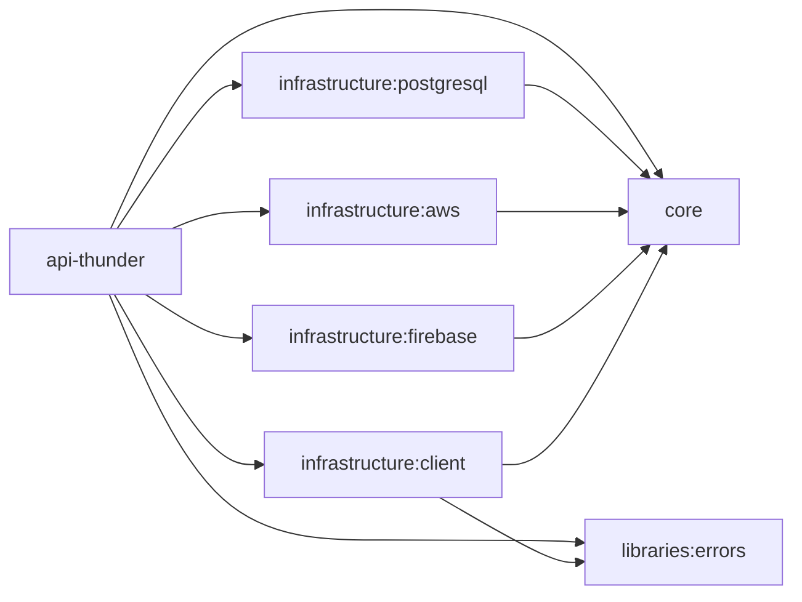

# Thunder API

This is a HTTP API server build with Spring Boot. It provides data and features for Thunder Flutter App.

## Table of Contents
- [Architecture](#architecture)
- [Installation](#installation)

## Architecture

Module placement, dependency rules, and naming rules are in [docs/architecture.md](./docs/architecture.md).

### Installation
- need JDK 21 to run Gradle (the Gradle 8.11 wrapper does not run on JDK 25)
- Docker must be running for `./gradlew build` (tests start PostgreSQL with Testcontainers)
- environment variables file (provided by Thunder App Team)
